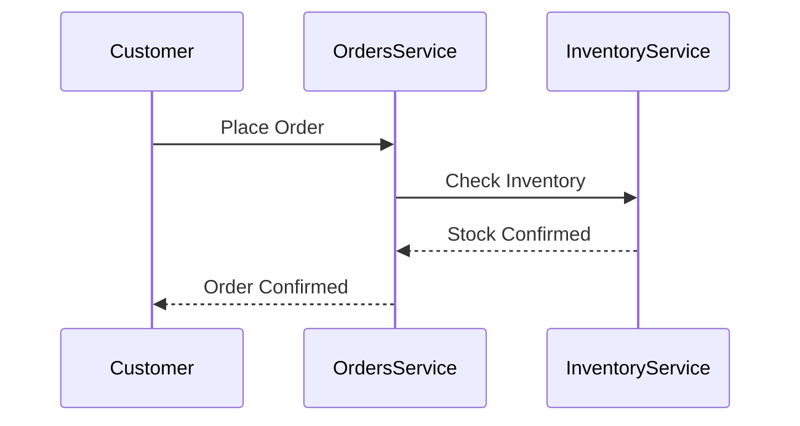

# Components and Features

EventCatalog provides built-in components and features you can use in any `.mdx` file to create rich, interactive documentation.

## Resource References (Wiki-style Links)

Use double square brackets to create inline links to any resource. These render as styled, interactive elements with hover tooltips showing resource details.

**Syntax:** `[[type|ResourceName]]`

| Resource Type | Syntax | Example |
|---|---|---|
| Service | `[[service\|Name]]` | `[[service\|OrdersService]]` |
| Agent | `[[agent\|Name]]` | `[[agent\|OrderSupportAgent]]` |
| Event | `[[event\|Name]]` | `[[event\|OrderCreated]]` |
| Command | `[[command\|Name]]` | `[[command\|CreateOrder]]` |
| Query | `[[query\|Name]]` | `[[query\|GetOrderStatus]]` |
| Domain | `[[domain\|Name]]` | `[[domain\|E-Commerce]]` |
| System | `[[system\|Name]]` | `[[system\|checkout-system]]` |
| Flow | `[[flow\|Name]]` | `[[flow\|PaymentFlow]]` |
| Channel | `[[channel\|Name]]` | `[[channel\|OrderChannel]]` |
| Entity | `[[entity\|Name]]` or `[[Name]]` | `[[entity\|Order]]` or `[[Order]]` |
| Data Product | `[[data-product\|Name]]` | `[[data-product\|order-analytics]]` |
| ADR | `[[adr\|Name]]` | `[[adr\|adr-001-choose-event-driven-orders]]` |
| Diagram | `[[diagram\|Name]]` | `[[diagram\|order-flow]]` |
| Container | `[[container\|Name]]` | `[[container\|payments-db]]` |
| User | `[[user\|Name]]` | `[[user\|dboyne]]` |
| Team | `[[team\|Name]]` | `[[team\|backend-team]]` |
| Custom Doc | `[[doc\|path]]` | `[[doc\|guides/getting-started]]` |

**Version pinning:** `[[service|OrdersService@1.0.0]]` links to a specific version.

**Entity shorthand:** `[[Customer]]` resolves to `[[entity|Customer]]`.

**Example in context:**

```markdown
The [[service|OrdersService]] handles all order processing and publishes
[[event|OrderCreated]] when an order is placed. It integrates with
[[service|PaymentService]] for payment processing, belongs to
[[system|checkout-system]], works with
[[agent|OrderSupportAgent]] for support workflows, and writes to the
[[container|orders-db]] database. See [[adr|adr-001-choose-event-driven-orders]]
for the architecture decision and [[diagram|order-flow]] for the sequence diagram.
```

Use resource references liberally in documentation body text to create a connected, navigable catalog.

---

## Mermaid Diagrams

EventCatalog supports Mermaid v11.x diagrams inline in any `.mdx` file.

### Code Block Approach

````markdown

````

### File-Based Loading

Place `.mmd` or `.mermaid` files alongside the `index.mdx` and load them:

```markdown
<MermaidFileLoader file="architecture.mmd" />
```

### Supported Diagram Types

- **Sequence diagrams** — show message flow between services
- **Class diagrams** — show data models and relationships
- **Entity Relationship diagrams** — show database schemas
- **Architecture diagrams** — show infrastructure with icons (supports 200,000+ icons from icones.js.org)

### Architecture Diagram with Icons

```mermaid
architecture-beta
    group api(logos:aws)

    service db(logos:aws-aurora)[Order DB] in api
    service disk1(logos:aws-s3)[Order Metadata] in api
    service server(logos:aws-lambda)[Order Handler] in api

    db:L -- R:server
    disk1:T -- B:server
```



Use when documenting service infrastructure. Icon packs must be configured in `eventcatalog.config.js`:

```javascript
mermaid: {
  iconPacks: ['logos']
}
```

---

## Built-in Components

### `<NodeGraph />`

Renders an interactive architecture visualization showing the resource and its relationships (sends/receives, producers/consumers, read/write dependencies).

```markdown
<NodeGraph />
```

Props:
- `mode="full"` — expanded view showing all connections
- `search="false"` — hide search bar
- `legend="false"` — hide legend
- `title="My Title"` — custom title
- Can render a specific resource: `<NodeGraph id="Orders" version="0.0.3" type="domain" />`

**Use in:** Agents, services, events, commands, queries, domains, systems, flows, channels, containers and data products. This is the primary visualization component. It renders nothing on entities, diagrams, teams, users or ADRs (use `<EntityMap />` for entities).

### `<ContextDiagram />`

Renders a system context diagram showing systems, system-to-system relationships, and actors.

```markdown
<ContextDiagram />
```

**Use in:** Systems and domains. Include on system pages when `relationships` or `actors` are defined. Include on domain pages when the domain references systems that define relationships or actors.

### `<Schema />` and `<SchemaViewer />`

Render schema files (JSON Schema, Avro, Protobuf, YAML).

```markdown
<!-- Raw schema display -->
<Schema file="schema.json" title="Order Schema" />

<!-- Interactive schema browser -->
<SchemaViewer file="schema.json" title="JSON Schema" maxHeight="500" showRequired="true" expand="true" search="true" />
```

Schema files must be in the same directory as the `index.mdx`.

**Use in:** Events, commands, queries — any resource with a schema.

### `<MessageTable />`

Renders a table of messages (events, commands, queries) that a service sends and receives.

```markdown
<MessageTable format="all" limit={4} />
```

**Use in:** Services and domains to show message summary.

### `<AgentTools />`

Renders a table of tools configured on an agent.

```markdown
<AgentTools />
```

**Use in:** Agents only. Include when the agent frontmatter has a `tools` array.

### `<ChannelInformation />`

Renders channel metadata (protocols, delivery guarantee, parameters, routing).

```markdown
<ChannelInformation />
```

**Use in:** Channels only.

### `<Flow />`

Embeds a flow visualization from another flow resource into any page.

```markdown
<Flow id="CancelSubscription" version="latest" lanes="team" walkthrough="true" />
```

Props:
- `id`, `version` (default `latest`), `mode="simple|full"`, `maxHeight`
- `lanes="domain|system|team|domain-system"` — start the flow grouped. Groups come from each step's domain, system and owners, so the flow needs no extra frontmatter
- `walkthrough="true"` — show the step-by-step walkthrough
- `search="true"` — show the search bar (default off)
- `legend={false}` (alias `includeKey`) — hide the legend

**Use in:** Domain or service pages to show related business flows.

### `<Tiles />` and `<Tile />`

Render clickable tile cards for navigation. `<Tiles>` takes optional `title` and `columns` (default 2). `<Tile>` takes `href`, `icon`, `title`, `description` and optional `openWindow`. `icon` must be a [Heroicons](https://heroicons.com) 24/solid component name (e.g. `DocumentIcon`).

```markdown
<Tiles>
    <Tile icon="DocumentIcon" href="/docs/..." title="View changelog" description="See history" />
    <Tile icon="UserGroupIcon" href="/docs/teams/..." title="Contact team" description="Questions?" />
</Tiles>
```

**Use in:** Any resource to provide quick navigation to related pages.

### `<Steps />` and `<Step />`

Render numbered step-by-step instructions.

```markdown
<Steps title="How to connect">
  <Step title="Install the SDK">
    ```bash
    npm install my-sdk
    ```
  </Step>
  <Step title="Initialize the client">
    ```js
    const client = new Client({ apiKey: 'YOUR_KEY' });
    ```
  </Step>
</Steps>
```

**Use in:** Services to document how other teams can integrate.

### `<Tabs />` and `<TabItem />`

Render tabbed content for showing alternatives (e.g., code in multiple languages).

```markdown
<Tabs>
  <TabItem title="Python">
    ```python
    producer.send('topic', event_data)
    ```
  </TabItem>
  <TabItem title="TypeScript">
    ```typescript
    await producer.send({ topic: 'topic', messages: [{ value: data }] });
    ```
  </TabItem>
</Tabs>
```

**Use in:** Events and services to show multi-language code examples.

### `<Accordion />` and `<AccordionGroup />`

Collapsible content sections.

```markdown
<AccordionGroup>
  <Accordion title="How do I get access?">
    Submit a request via ServiceNow...
  </Accordion>
  <Accordion title="What about staging?">
    Use the staging connection string...
  </Accordion>
</AccordionGroup>
```

**Use in:** Containers, services — for FAQ-style content.

### `<ResourceLink />`

Creates a styled link to a resource (alternative to wiki-style references).

```markdown
<ResourceLink id="Orders" type="domain">Orders Domain</ResourceLink>
```

**Use in:** When you need more control over the link text than `[[type|name]]` provides.

### `<ADRTable />`

Lists the ADRs that apply to the current resource (via the ADR's `appliesTo`).

```markdown
<ADRTable status="accepted,proposed" limit={10} />
```

Props: `status` (one status or a comma-separated list; all when omitted), `limit` (page size, default 10).

**Use in:** Domains, systems and services that have architecture decisions.

### `<EntityMap />` and `<EntityPropertiesTable />`

`<EntityMap />` draws the entities of a domain or service and their relationships (the "Entity Diagram"). `<EntityPropertiesTable />` renders an entity's `properties` as a table.

```markdown
<EntityMap id="Orders" entities={['Order', 'OrderItem']} maxHeight="600" />
<EntityPropertiesTable />
```

**Use in:** `<EntityMap />` on domain and service pages (`id`, `version`, `entities` and `includeKey` are optional). `<EntityPropertiesTable />` on entity pages.

### `<CustomProperties />` and `<CustomProperty />`

Render the resource's custom `x-` frontmatter properties. Unknown frontmatter keys fail the build unless they start with `x-`, so put custom metadata in `x-*` keys and show it with these.

```markdown
<CustomProperties title="Operational details" />
<CustomProperty name="x-cost-centre" label="Cost centre" />
```

**Use in:** Any resource with `x-*` properties.

### `<Attachments />`

Renders the resource's frontmatter `attachments` (URLs, or `{ url, title, type, description, icon }`) as cards. Props: `title`, `description`, `columns` (default 2).

### `<ResourceGroupTable />`

Renders a table of the resources in a `resourceGroups` group. Props: `id` (the group id), `limit`, `title`, `subtitle`, `description`, `showOwners`, `showTags`.

### `<ArchitectureGraph />`

Embeds the catalog's architecture graph (the homepage graph). Optional `id` and `collection` focus it on a resource.

### Layout helpers

- `<Admonition type="info|note|tip|warning|alert|danger" title="...">` — callout box.
- `<CodeGroup>` — wrap several fenced code blocks into one tabbed block (`dropdown` for a select menu).
- `<Columns cols={2}>` with `<Column>` children — side-by-side content (`ratio`, `sticky` on a column).
- `<Prompt description="..." />` — a copyable AI prompt card.

### Embeds

| Component | Required prop | Notes |
|---|---|---|
| `<Miro />` | `boardId` | `height`, `title`, `edit`, `moveToWidget`, `moveToViewport` |
| `<Lucid />` | `diagramId` | `height`, `title` |
| `<DrawIO />` | `url` | `height`, `title` |
| `<FigJam />` | `url` | `height`, `title` |
| `<IcePanel />` | `url` | `height`, `width`, `title`, `description` |
| `<LikeC4View />` | `viewId` | `project`, `height` — renders a view from LikeC4 `.c4` sources in the catalog |

### API specifications

Don't use `<OpenAPI />` or `<AsyncAPI />` — they're deprecated and only render a notice. Attach specifications in frontmatter instead; EventCatalog renders them on their own pages:

```yaml
specifications:
  - type: openapi        # openapi | asyncapi | graphql | generic
    path: openapi.yml
    name: Orders API
  - type: generic        # any other contract, e.g. WSDL or XSD
    path: orders.wsdl
    name: Orders SOAP
```

---

## When to Use What

| Need | Component |
|------|-----------|
| Show architecture relationships | `<NodeGraph />` |
| Link to another resource inline | `[[type\|Name]]` resource references |
| Show a schema | `<SchemaViewer />` or `<Schema />` |
| Show infrastructure | Mermaid architecture diagram |
| Show message flow sequence | Mermaid sequence diagram |
| Show database schema | Mermaid ER diagram or PlantUML |
| List service messages | `<MessageTable />` |
| List agent tools | `<AgentTools />` |
| Show channel details | `<ChannelInformation />` |
| Multi-language code examples | `<Tabs />` |
| Step-by-step integration guide | `<Steps />` |
| Embed a business flow | `<Flow />` |
| Quick navigation cards | `<Tiles />` |
| List decisions for a resource | `<ADRTable />` |
| Show entities and relationships | `<EntityMap />` |
| Show custom `x-` properties | `<CustomProperties />` |
| Show an API spec | `specifications` frontmatter |
| Embed Miro, Lucid, draw.io, FigJam, IcePanel or LikeC4 | The matching embed component |
